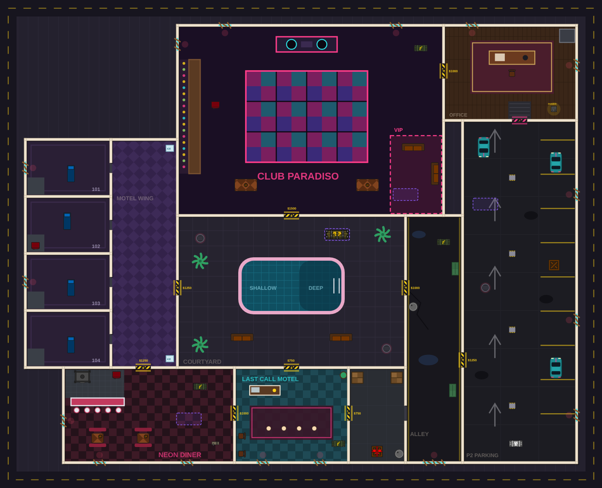

# Last Call layout (Zombie Survival `specops_complex`)

Last Call is the motel, nightclub and parking-garage map in Zombie Survival.
This update rebuilds its block from a single layout file, with one painted
night-time floor. The rules are unchanged: buy gates, power, the mystery box,
the upgrade bench and zombie waves all run through the existing Zombie Survival
code in `SpecOpsManager`.

*The preview is put together from the map's SVGs and the generated object
positions, not captured from the game client.*

## What changed

- **Layout:** nine rooms in a 217.5 × 172.5 block (the 145 × 115 plan scaled
  1.5×): lobby, storage, courtyard, neon diner, alley, motel wing, Club
  Paradiso, the manager's office and the parking garage. The map is 256 × 208.
  - Doorways are 6 units wide.
  - Motel room doorways are open. Hinged doors used to snag zombies.
  - Furniture and cover are placed for close fights in the style of Hotline
    Miami.
- **Art:** one generated floor image draws the walls, floors, boarded windows,
  door prices, box spots and manholes. It's built from the same plan as the
  collision walls, so the two can't drift apart. Shutters, the freight gate,
  pillars, cars and dumpsters have their own sprites (the `lastcall` atlas).
- **Gates:** `zombie_buy_gate_*` are now yellow-and-black rolling shutters
  (6 × 1.2). `zombie_power_gate` is a pink freight gate. `zombie_garage_car`
  uses the new car sprite.
- **Zombie spawns:** zombies only climb in through windows and manholes in
  rooms the squad has opened. Rooms are tracked by walking the plan's doorways
  from where the players are, so they can never appear behind an unbought
  shutter, even when an earlier path check would have allowed it. A window
  can take a few zombies at once, and windows close to players are only used
  when every other one is taken.
- **Zombie routing on this map:**
  - extra waypoints on a 6-unit grid and around props;
  - linked nodes through every opened doorway;
  - nav links a zombie can't fit through are dropped;
  - path ends are never accepted from the room next door;
  - path-cache keys include the room at each end;
  - zombies walk to the farthest waypoint they can reach in a straight line.

  All of this only switches on for `specops_complex`.

Removed because nothing uses them any more: the old 10-unit grid builder
(`createZombieBranchingComplex`), `zombie_pool_edge_10`, `zombie_entry_window`,
`createZombieBuyGate`, and the `map-zombie-floor-*` and `map-zombie-garage-car`
SVGs (these were in the shared atlas, which every map loads).

## Files

| File | What it is |
|------|------------|
| `shared/defs/maps/lastCallLayout.ts` | The plan: rooms, doorways, windows, stations, props, box spots. Edit this first. |
| `shared/defs/lastCallObjectDefs.ts` | Walls and props generated from the plan, and the `zombie_branching_complex_01` building. |
| `server/src/game/lastCallNav.ts` | Which rooms are open, doorway nav nodes, the "does a zombie fit" check. |
| `scripts/lastcall/buildArt.ts` | Regenerates the floor and prop SVGs from the plan. |
| `client/atlas-builder/defs/lastcall.ts` | The `lastcall` atlas. |
| `tests/src/lastCall.test.ts` | Layout, open-room and pathing tests. |

## Changing the size

`LastCallScale` in `lastCallLayout.ts` sets how big the rooms are (1 = the
original 145 × 115 plan, 1.5 now).
- **Rooms** grow, and so do built-in fixtures (pool, bar, DJ booth, counters,
  desks).
- **Furniture, stations, cars and the box** keep their real size and move with
  the room. Anything within 4.5 units of a wall stays the same distance from
  that wall.
- **Doorways and windows** keep their width, so shutters stay chokepoints.

After changing it:
1. Set `baseWidth`/`baseHeight` of `ZombieBranchingComplex` in
   `zombieIndoorDefs.ts` to at least the block size plus about 40.
2. Run `bun scripts/lastcall/buildArt.ts`.
3. Update the map-size line in `zombieMode.test.ts`.

The floor image is drawn at 16 / LastCallScale px per unit, so its texture size
doesn't grow with the map.

## Changing the map

1. Edit the base tables in `lastCallLayout.ts`. Coordinates are base-plan
   units: x to the right, y down, origin at the block's top-left corner.
2. Run `bun scripts/lastcall/buildArt.ts` so the floor art matches the new walls.
3. Run `bun run lint`, then the tests: `cd tests && bun run test lastCall zombieMode`.
